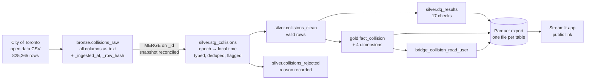
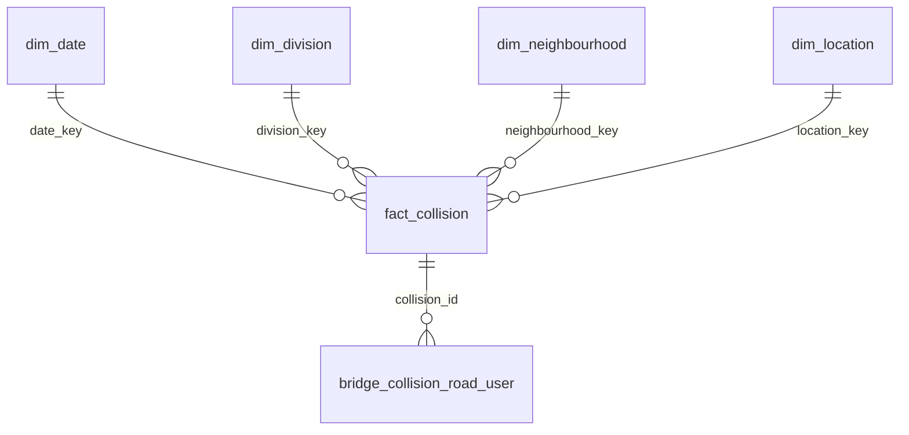

# Architecture

## Pipeline

## Star schema

## Rules the model follows

| Rule | Why |
|---|---|
| Grain of `fact_collision` = one occurrence (`_id`) | Every measure is additive at that level |
| Unknown members use key `0` | Unknowns stay countable instead of becoming blanks |
| A collision is rejected only if unusable (no id, no timestamp, impossible year, negative fatalities) | Bad coordinates do not make the incident fake — they are nulled and flagged |
| `OCC_DATE` is epoch ms at local midnight | `try_to_timestamp()` returns NULL for it; the time of day lives in `OCC_HOUR` |
| `NSA` and `0/0` coordinates are mapped to NULL | They are "unassigned", not real neighbourhoods or places |
| Export is blocked while any `error` check fails | Bad data cannot reach the dashboard |
